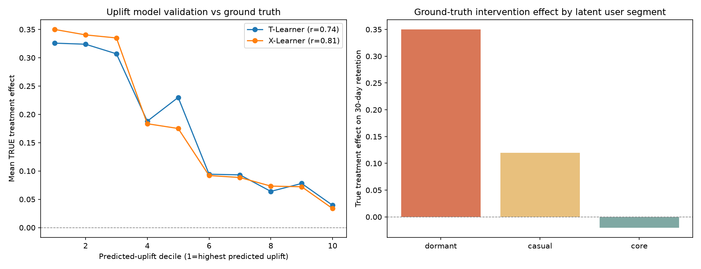
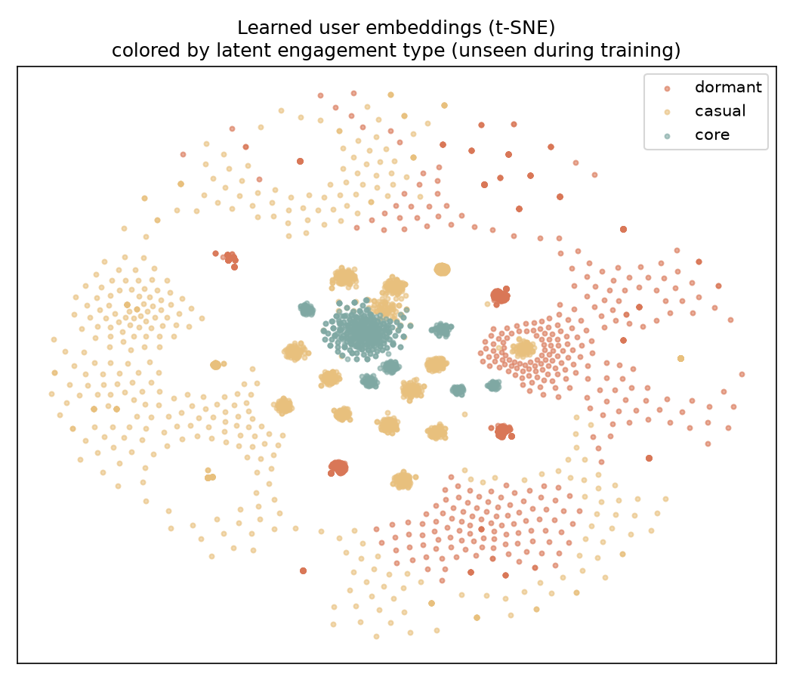

# OTT Retention Intelligence — Transformer + Causal Uplift Modeling

[](https://www.python.org/)
[](https://pytorch.org/)
[](https://scikit-learn.org/)

A self-contained research project that combines **a SASRec-style self-attentive
transformer** (built from the architecture level in PyTorch) with **T-Learner /
X-Learner causal uplift modeling** to answer the question OTT platforms care
about most: *given a user's watch history, who should we send a retention
intervention to — and does it actually help them?*

Every claim is validated against **known ground truth** on a semi-synthetic
dataset (the standard way causal-ML papers validate uplift methods), so the
pipeline is fully reproducible end-to-end.


*X-Learner vs T-Learner: mean TRUE treatment effect per predicted-uplift decile (1 = highest predicted uplift), validated on held-out users.*

---

## The problem

OTT platforms know two things they'd love to reconcile:

1. **What a user's watch history says about the value they get** from the platform, and
2. **If we intervene** (e.g., a personalized recommendation push), **who does it actually help?**

Naive correlation — *"users who got the nudge retained more"* — conflates the
intervention's effect with the fact that already-engaged users were more likely
to get (and respond to) it. This project builds both pieces and validates the
causal piece against ground truth.

## Approach

### 1. Synthetic OTT dataset with known causal ground truth — `src/generate_data.py`

Real-world uplift ground truth ("what would have happened without the
intervention") never exists, so — following the standard practice in the uplift
literature (e.g. CausalML / Uplift Modeling papers) — the dataset is simulated:

- **4,000 users** with latent engagement segments (`dormant` / `casual` / `core`) that drive both watch behavior *and* treatment responsiveness
- **400 shows** with genre-mixture vectors and popularity scores
- **Watch sequences** whose length and genre-consistency vary by latent segment
- A **randomized (RCT-style) intervention** with a **known heterogeneous treatment effect** on 30-day retention:
  `dormant +0.35`, `casual +0.12`, `core −0.02`

The models never observe `engagement_type` directly — only raw watch sequences
and the intervention outcome, exactly like production.

### 2. SASRec-style transformer — `src/transformer_model.py`

A self-attentive sequential recommender (Kang & McAuley, 2018) implemented from
scratch in PyTorch — causal (autoregressive) masking, learned positional
embeddings, tied input/output embeddings — trained on **next-item prediction**
over watch sequences. The hidden state at the user's last watched position is
extracted as a dense **64-dim behavioral embedding**, which feeds the uplift
models.

**Training (8 epochs, CPU):**

| Epoch | 1 | 2 | 3 | 4 | 5 | 6 | 7 | 8 |
|---|---|---|---|---|---|---|---|---|
| Next-item loss | 20.18 | 13.38 | 10.82 | 9.28 | 8.30 | 7.65 | 7.22 | **6.91** |

### 3. Causal uplift modeling — `src/causal_uplift.py`

Two standard heterogeneous-treatment-effect estimators, using the learned
embeddings as covariates:

- **T-Learner** — two separate outcome models (treated vs control); uplift = predicted-outcome difference
- **X-Learner** (Künzel et al., 2019) — cross-imputes individual treatment effects and combines them, which handles imbalanced/heterogeneous effects better

Because assignment was randomized, both can be scored directly against
ground-truth treatment effects on **held-out users** (30% test split).

### 4. Embedding sanity check — `src/visualize_embeddings.py`

t-SNE projection of the learned embeddings, colored by the latent
`engagement_type` the transformer never saw:


*Clean clustering by an unseen label is evidence the transformer recovered real behavioral signal from raw sequences.*

## Results

| Model | Correlation with true treatment effect |
|---|---|
| T-Learner | **0.74** |
| X-Learner | **0.81** |

**X-Learner decile targeting** — mean *true* treatment effect by predicted-uplift decile (top → bottom), held-out users:

| Decile | 1 | 2 | 3 | 4 | 5 | 6 | 7 | 8 | 9 | 10 |
|---|---|---|---|---|---|---|---|---|---|---|
| True effect | 0.350 | 0.340 | 0.335 | 0.184 | 0.175 | 0.092 | 0.089 | 0.073 | 0.072 | 0.034 |

Strictly monotonic: users ranked highest by predicted uplift genuinely benefit
the most, and the bottom decile gains only +0.03. Using only behavioral
embeddings, the model correctly recovers *who the intervention actually helps* —
not just who's already engaged.

**Practical output:** `outputs/recommended_targeting.csv` — a ranked list of
which users should receive the intervention, based on predicted uplift.

## Getting started

```bash
# 1. Clone & set up
git clone <this-repo-url>
cd ott-causal-llm
python -m venv venv
venv\Scripts\activate          # Windows  |  source venv/bin/activate (macOS/Linux)
pip install -r requirements.txt

# 2. Reproduce everything, in order
python src/generate_data.py         # 1. synthetic dataset + causal ground truth
python src/transformer_model.py     # 2. train SASRec transformer, extract embeddings
python src/causal_uplift.py         # 3. T-Learner / X-Learner uplift + validation
python src/visualize_embeddings.py  # 4. t-SNE embedding sanity check
```

Outputs land in `data/` (dataset, embeddings) and `outputs/` (plots, targeting CSV).

## Repository structure

```
ott-causal-llm/
├── src/
│   ├── generate_data.py         # synthetic OTT dataset with known causal ground truth
│   ├── transformer_model.py     # SASRec-style transformer (causal masking, positional embeddings)
│   ├── causal_uplift.py         # T-Learner / X-Learner uplift modeling + validation
│   └── visualize_embeddings.py  # t-SNE sanity check of learned embeddings
├── data/                        # generated dataset + learned embeddings (gitignored artifacts)
├── outputs/                     # validation plot, t-SNE plot, targeting recommendations
├── requirements.txt
└── README.md
```

## Key techniques

- **Sequential recommendation** — SASRec (Kang & McAuley, 2018): causally-masked self-attention, positional embeddings, tied embedding weights
- **Causal inference** — T-Learner & X-Learner (Künzel et al., 2019); RCT-based ground-truth validation instead of trusting model outputs
- **Representation learning** — the transformer's hidden state doubles as a user embedding; t-SNE verifies it recovered latent structure

## Honest limitations

- **Synthetic data** — the point is methodological (does the pipeline correctly recover a *known* causal effect?), not a claim about real OTT retention dynamics
- **No pretrained-LLM fine-tuning** — the transformer is trained from scratch; a natural next step is fine-tuning a small pretrained LM on watch sequences as text, and/or using an LLM to explain *why* a segment responds to an intervention
- **Randomized assignment only** — no propensity estimation was needed; a real deployment on observational (non-RCT) data would require it

## License

MIT
